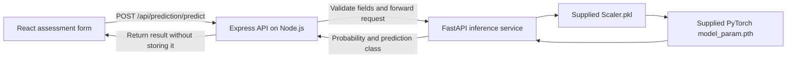

# AlzAI prediction services

The website uses React for its interface and Express on Node.js for the application API. FastAPI runs only the feature-based inference that requires the supplied PyTorch model and scaler. The application does not use a database and does not save prediction requests or results.

FastAPI runs at `http://127.0.0.1:8000`. Express runs at `http://127.0.0.1:5000`. The Vite development server proxies `/api` requests to Express.

Place the supplied `model_param.pth` and `Scaler.pkl` files in `backend/models/`. The service reports the model unavailable if either artifact is missing or cannot be loaded.

From the project root, run `npm install`, copy `.env.example` to `.env`, then run `npm run dev` to start the React and Express development servers. In another terminal, create and activate a Python virtual environment in `backend`, install `backend/requirements.txt`, and run `uvicorn app.main:app --reload --port 8000` from the `backend` folder.

For a production frontend build, run `npm run build`. Express serves the generated files from `frontend/dist` when that directory exists.

The prediction is informational and is not a medical diagnosis.
